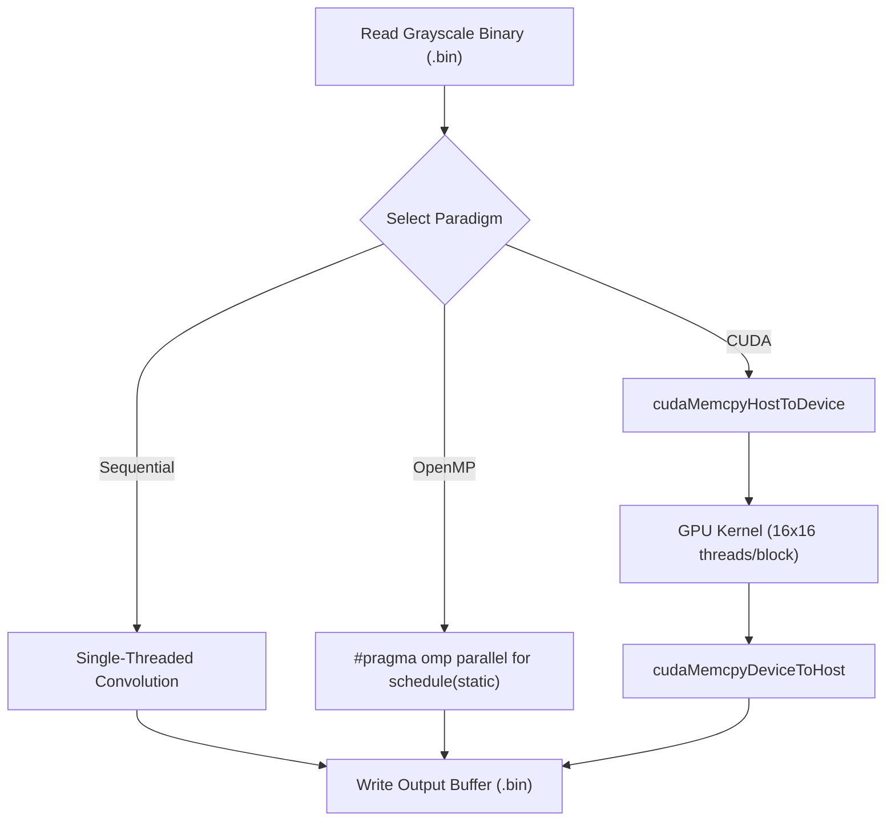

# Final PA-1 Report Skeleton & Analysis

This document is structured **exactly according to Section 5 of the PA-1 Guidelines ("What Must Be Included in the Report")**. It evaluates the state of the notebooks for every single section, provides the data where available, and explicitly flags sections that are missing or defective.

---

### Cover Page
* **Status:** ❌ **[MISSING in Notebooks]**
* **Analysis:** You must manually create the Cover Page using the exact format provided on Page 3 of the `.docx` file (Group Number, Roll Numbers, Submission Date, and Google Drive Link).

---

### 1. Problem statement and brief application description.
* **Status:** ❌ **[MISSING in Notebooks]**
* **Draft Content for Report:** This project implements 2D image sharpening using spatial convolution. The application applies a standard 3x3 Laplacian filter to raw 8-bit grayscale binary images, enhancing high-frequency edge details by computing a weighted sum of neighboring pixels.

### 2. Overall processing workflow depicted using flowchart.
* **Status:** ❌ **[MISSING in Notebooks]**
* **Draft Content for Report (Mermaid Flowchart):**

### 3. Sequential and parallel portions with justification.
* **Status:** ✅ **[COMPLETED in Notebooks]**
* **Analysis:** The notebooks correctly identify that file I/O operations and dynamic memory allocations execute sequentially. The nested loops iterating over the image grid to apply the convolution kernel are inherently data-parallel because each output pixel is computed independently.

### 4. Data/task decomposition, dependencies, and synchronization.
* **Status:** ✅ **[COMPLETED in Notebooks]**
* **Analysis:** The OpenMP notebook correctly documents a 1D row-based domain decomposition using static loop scheduling (`schedule(static)`). There are no loop-carried data dependencies, and the input buffer is read-only. Consequently, no mutual exclusion (mutexes or locks) is required, making the core computation embarrassingly parallel.

### 5. Sequential, OpenMP, CUDA, and optimized implementation approach.
* **Status:** ✅ **[COMPLETED in Notebooks]**
* **Analysis:** All 4 versions are successfully implemented as separate C++ files. 
  - Sequential uses standard C++ compiled with `-O3`. 
  - Basic OpenMP uses `#pragma omp parallel for`. 
  - Optimized OpenMP uses `#pragma omp simd` and branch elimination. 
  - CUDA uses a 2D grid of 16x16 thread blocks.

### 6. Input/data generation or preparation and input sizes.
* **Status:** ✅ **[COMPLETED in Notebooks]**
* **Analysis:** A Python script utilizing OpenCV (`cv2`) downloads a JPEG, converts it to grayscale, resizes it, and serializes it to raw `.bin` bytes. Three sizes are properly generated: Small (1920x1080), Medium (3840x2160), and Large (7680x4320).

### 7. Representative input/output and correctness comparison.
* **Status:** ⚠️ **[PARTIALLY MISSING in Notebooks]**
* **Analysis:** The notebooks use `matplotlib` to display zoomed Before/After visual comparisons perfectly. However, the **CUDA notebook's automated verification check is broken**. Because Colab allocates separate virtual machines for CPU and GPU sessions, the CUDA notebook cannot access the `output_small.bin` generated by the Sequential notebook. You must manually download the sequential outputs and upload them to the CUDA session to pass verification.

### 8. Hardware/software environment and timing methodology.
* **Status:** ⚠️ **[PARTIALLY MISSING in Notebooks]**
* **Analysis:** The CPU notebooks probe RAM and the CUDA notebook probes `nvidia-smi`, but a formal written summary is missing. Furthermore, the timing methodology is flawed: **The CPU notebooks (Sequential and OpenMP) only run the binary once**, failing the guideline to average multiple runs. (CUDA correctly runs 5 times).
* **Environment Specs for Report:** Google Colab CPU Runtime (2 logical vCPUs, Intel Xeon @ 2.20GHz, ~12GB RAM) and GPU Runtime (NVIDIA Tesla T4, 15.3GB VRAM). OpenMP timings use `omp_get_wtime()` and CUDA uses `cudaEventElapsedTime()`.

### 9. Execution-time table, speedup, efficiency where applicable, and performance plots.
* **Status:** ⚠️ **[PARTIALLY MISSING in Notebooks]**
* **Analysis:** The execution times are printed, but **the notebooks do not programmatically calculate Speedup ($S_p$) or Efficiency ($E_p$)** because the sequential baseline time isn't shared across Colab sessions. Furthermore, **no performance plots (graphs) are generated** in any notebook. You must create these plots for the report.
* **Pre-calculated Data for your Tables:**

| Dataset | Sequential ($T_{seq}$) | OpenMP ($T_{omp}$) | Opt. OpenMP ($T_{opt}$) | CUDA Kernel | CUDA Total |
|---|---|---|---|---|---|
| **Small** | 65.92 ms | 39.42 ms ($S_p$: **1.67x**, $E_p$: **83.5%**) | 20.75 ms ($S_p$: **3.18x**, $E_p$: **159%**) | 0.27 ms | 1.46 ms |
| **Medium**| 163.86 ms | 150.53 ms ($S_p$: **1.09x**, $E_p$: **54.5%**) | 23.14 ms ($S_p$: **7.08x**, $E_p$: **354%**) | 0.44 ms | 4.39 ms |
| **Large** | 629.79 ms | 424.60 ms ($S_p$: **1.48x**, $E_p$: **74.0%**) | 77.27 ms ($S_p$: **8.15x**, $E_p$: **407%**) | 1.28 ms | 16.62 ms |

### 10. CUDA kernel-time vs total/end-to-end-time comparison.
* **Status:** ✅ **[COMPLETED in Notebooks]**
* **Analysis:** The CUDA notebook accurately measures and splits Kernel time from Total time. (e.g., Large Image: Kernel = 1.28 ms, Total = 16.62 ms).

### 11. Comparison of Sequential vs OpenMP, CPU vs CUDA, and basic vs optimized implementation.
* **Status:** ❌ **[MISSING in Notebooks]**
* **Analysis:** The code outputs the numbers separately, but there is no markdown text summarizing the comparison. You must write this: Basic OpenMP is limited by 2 vCPUs (max ~1.6x speedup). Optimized OpenMP leverages vectorization to hit 8.1x speedup on the same CPU. CUDA obliterates CPU performance with a 492x kernel speedup.

### 12. Optimization explanation and measured effect.
* **Status:** ✅ **[COMPLETED in Notebooks]**
* **Analysis:** The `Optimized_OpenMP_Image_Sharpening.ipynb` markdown perfectly explains boundary decoupling (eliminating branch predictions) and SIMD vectorization. The measured effect is massive: increasing speedup from 1.48x to 8.15x on the large image.

### 13. Discussion of cases where parallelization does not help, conclusion, and individual contributions.
* **Status:** ❌ **[MISSING in Notebooks]**
* **Analysis:** No text exists for this. You must write the conclusion, outline individual group member contributions, and discuss cases where parallelization overhead hurts (e.g., the PCIe Host-to-Device transfer bottleneck dropping CUDA speedup from 492x to 37x, or thread-spawning overhead for extremely tiny images).
